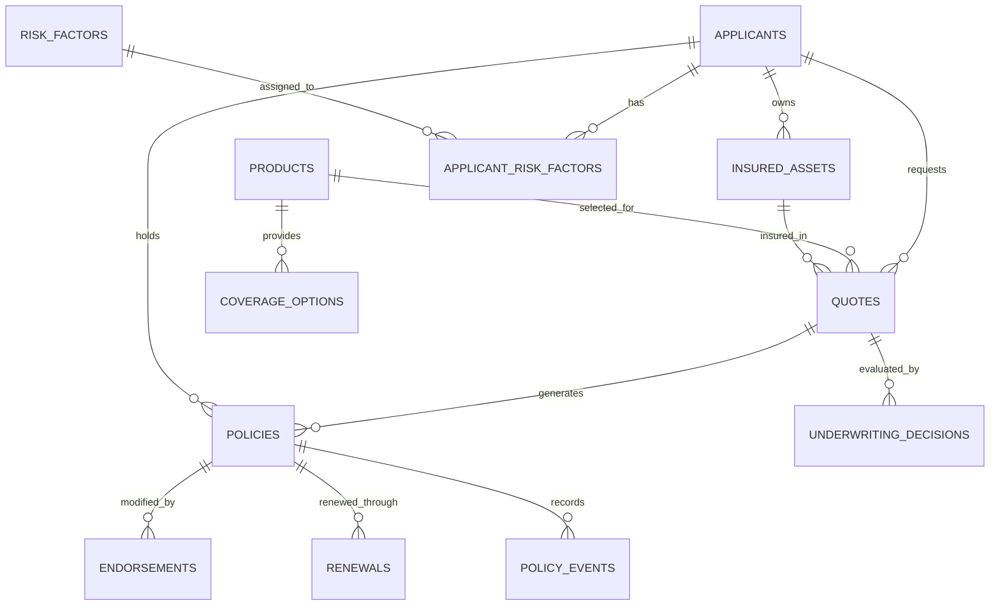

# Insurance Underwriting System — Database Schema

## 1. Overview

The Insurance Underwriting System uses a relational SQLite database managed through SQLAlchemy ORM.

The database contains master data, transaction records, underwriting decisions and policy lifecycle events.

## 2. Database Tables

### Master Data Tables

| Table | Primary Key | Purpose |
|---|---|---|
| applicants | id | Stores synthetic applicant information |
| insured_assets | id | Stores applicant-owned insured assets |
| products | id | Stores insurance product definitions |
| coverage_options | id | Stores product coverage options |
| risk_factors | id | Stores underwriting risk factors |
| applicant_risk_factors | applicant_id + risk_factor_id | Connects applicants and risk factors |

### Transaction Tables

| Table | Primary Key | Purpose |
|---|---|---|
| quotes | id | Stores customer quote requests |
| policies | id | Stores issued insurance policies |
| endorsements | id | Stores changes made to policies |
| renewals | id | Stores policy renewal offers |
| underwriting_decisions | id | Stores underwriting evaluations |
| policy_events | id | Stores policy lifecycle history |

## 3. Entity Relationships



Note: The diagram represents the implemented foreign-key relationships. The Quote–Policy relationship is not enforced as one-to-one in the current database schema.

## 4. Database Relationship Details

### Applicant Relationships

- One applicant can own multiple insured assets.
- One applicant can request multiple quotes.
- Applicants can have multiple risk factors.
- The Applicant–RiskFactor relationship uses a bridge table.

### Product Relationships

- One product can contain multiple coverage options.
- Multiple quotes can reference the same product.

### Quote Relationships

- Each quote references an applicant.
- Each quote references a product.
- Each quote references an insured asset.
- Underwriting decisions reference quotes.
- Policies reference their source quotes.

### Policy Relationships

- Policies reference applicants and quotes.
- Policies can have multiple endorsements.
- Policies can have multiple renewal records.
- Policy lifecycle changes are stored in policy_events.

## 5. Data Flow Architecture

```text
MASTER DATA
    |
    +-- Applicants
    +-- Insured Assets
    +-- Products
    +-- Coverage Options
    +-- Risk Factors
    |
    v
QUOTE GENERATION
    |
    v
PREMIUM CALCULATION
    |
    v
UNDERWRITING EVALUATION
    |
    +-- Approved
    +-- Referred
    +-- Declined
    |
    v
CUSTOMER ACCEPTANCE AND PAYMENT
    |
    v
POLICY ISSUANCE
    |
    +-- Policy Events
    +-- Endorsements
    +-- Renewals
    |
    v
VALIDATION AND ANOMALY DETECTION
    |
    v
CSV / JSON / SQL EXPORTS
```

## 6. Data Integrity

The system uses primary keys to uniquely identify records and foreign keys to connect related entities.

Validation covers:

- Primary-key uniqueness.
- Foreign-key consistency.
- Required record counts.
- Policy acceptance and payment.
- Premium reconciliation.
- Policy date validity.
- Anomaly detection.
- Ground-truth comparison.

## 7. Database Technology

| Component | Technology |
|---|---|
| Programming language | Python |
| ORM | SQLAlchemy |
| Database | SQLite |
| Data processing | Pandas |
| Data generation | Faker and NumPy |
| Export formats | CSV, JSON and SQL |

## 8. Database File

Database filename: `insurance.db`

Location: Project root directory.

The database contains master records, transaction records, underwriting decisions and policy lifecycle events.